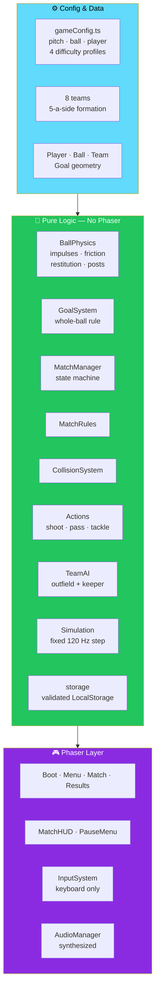

# ⚽ Kickoff Arena

<div align="center">


**A 2D top-down 5-a-side football game for the browser.**

*Deterministic physics · Tested AI · Phaser 3 rendering · Synthesized audio*

[⚠️ Status](#-status-read-this-first) • [🚀 Quick Start](#-quick-start) • [🎮 Controls](#-controls) • [🧠 How Systems Work](#-how-the-main-systems-work) • [🏗️ Architecture](#-project-layout)

</div>

---

## 📖 Overview

**Kickoff Arena** is a **2D top-down 5-a-side football game** for the browser.

### 🛠️ Stack

| Layer | Technology |
|-------|-----------|
| **Language** | TypeScript |
| **Build** | Vite |
| **Engine** | Phaser 3 *(Canvas)* |
| **Tests** | Vitest |

> ✅ **No external assets** — graphics are drawn in code and sound is synthesized with WebAudio.

### Core Idea

> **Gameplay-critical code is Phaser-free.**
>
> Everything that matters — ball physics, goals, match state, AI, keeper, storage — runs on a **fixed 120 Hz step**, is deterministic, and is testable in Node. **Phaser only draws and reads the keyboard.**

---

## ⚠️ Status (Read This First)

> **This is Phases 1–3 of the build plan, keyboard only.**
>
> **Be aware of what has and has not been verified.**

<div align="center">

| Area | State |
|------|:-----:|
| **Game logic** — ball physics, goals, match state machine, AI, keeper, storage | ✅ **Type-checked and unit-tested** — **34 tests passing**, run with a small stand-in for Vitest *(the authoring environment had no internet)*. **Please run `npm test` yourself** |
| **Headless AI-vs-AI simulation** — 12 three-minute matches | ✅ **Goals, saves, passes, and tackles occur; ball never got stuck** |
| **Phaser layer** — scenes, rendering, HUD, input, audio | ⚠️ **Written but never run in a browser** and **not type-checked against real Phaser types**. Expect **small fixes on first launch** |
| **`npm install`, `npm run build`, `npm run dev`** | ⚠️ **Not run** |

</div>

---

## 🚀 Quick Start

### 1. Install Node.js

**Node.js 18+** — from [nodejs.org](https://nodejs.org) *(LTS)*.

### 2. Open a Terminal

In this folder — **`kickoff-arena/`**.

### 3. Install Dependencies

```bash
npm install
```

### 4. Run the Dev Server

```bash
npm run dev
```

Open the printed local URL *(usually **http://localhost:5173**)*.

### 5. Run the Tests

```bash
npm run test
```

### 6. Build

```bash
npm run build      # type-checks and creates dist/
npm run preview    # serves the production build
```

### 7. Deploy

Upload the contents of **`dist/`** to any static host:

- **Netlify**
- **Vercel**
- **GitHub Pages**
- **Cloudflare Pages**

> 💡 **The build uses relative paths** *(`base: './'`)* — so it works from any subdirectory.

---

## 🎮 Controls

| Key | Action |
|-----|--------|
| **WASD / Arrows** | Move |
| **Shift** | Sprint *(uses stamina)* |
| **Space** | **Shoot** — hold to charge, release to kick. **Moving** = shoot where you face · **Standing still** = aim at goal |
| **J** | Pass to a teammate in your movement direction |
| **K** | Through pass into space |
| **L** | Tackle, or poke away a loose ball |
| **Q** | Switch to the teammate nearest the ball |
| **Esc** | Pause |

> 💡 **You also take control automatically of a teammate who receives the ball.**

---

## 🧠 How the Main Systems Work

### ⚽ Ball

- **Kicks** set velocity *(impulses)*
- **Exponential friction**
- **Restitution** against touchlines
- **Posts are circles**
- **The goal mouth is the only way past the goal line**
- **The net soaks up energy**

> 🔒 **A goal counts only when the whole ball is over the line inside the opening.**
>
> **`MatchManager.scoreGoal` ignores any call outside the `Playing` state** — so **a goal can never count twice**.

### 🎯 Possession

- **Slow balls within the control radius** are picked up and dribbled slightly ahead of the player
- **Fast balls are deflected** — keepers parry or catch
- **The previous kicker cannot re-collect for a moment**
- **Tackles can fail** and briefly stun the tackler

### 🧠 AI

**Per-player state machine:**

- **SupportAttack**
- **MoveToBall**
- **PressBall**
- **MarkOpponent**
- **InterceptPass**
- **ReceivePass**
- **CarryBall**
- **ReturnToFormation**

**Re-evaluated every 0.14–0.45 s depending on difficulty.**

**Formation slides with the ball.** Only a limited number of players may press.

**Difficulty changes:**

- Reaction time
- Pass and shot error
- Tackle rate and success
- Pressing numbers
- Keeper reaction and reach
- **World Class:** lane-cutting marking

> 💡 **Nobody gets a speed boost — Beginner is slightly slower.**

### 🧤 Keeper

- **Predicts where a shot will cross its line**
- **Moves there after a reaction delay**
- **Catches slow shots and parries fast ones**
- **Distributes the ball**

---

## 🏗️ Project Layout

```
kickoff-arena/
├── src/
│   ├── config/
│   │   └── gameConfig.ts     pitch · ball · player constants
│   │                         4 difficulty profiles
│   │                         (no Phaser import)
│   │
│   ├── data/                 teams (8 fictional)
│   │                         5-a-side formation
│   │
│   ├── entities/             Player · Ball · Team
│   │                         Goal geometry
│   │                         (plain classes, no Phaser)
│   │
│   ├── systems/              BallPhysics · GoalSystem
│   │                         MatchManager · MatchRules
│   │                         CollisionSystem · Actions
│   │                         TeamAI (outfield + keeper)
│   │                         Simulation · InputSystem
│   │                         AudioManager
│   │
│   ├── scenes/               Boot · Menu · Match · Results
│   │
│   ├── ui/                   MatchHUD · PauseMenu · widgets
│   │
│   └── utils/                math
│                             storage (validated LocalStorage)
│
└── tests/                    ballPhysics · goalSystem
                              matchManager · playerMovement
                              teamAI · storage
```

### System Overview



### Design Principles

<div align="center">

| Principle | Implementation |
|-----------|---------------|
| **🎯 Gameplay is Phaser-free** | Ball physics, goals, match state, AI, and keeper all live in plain classes — **testable in Node** |
| **⏱️ Deterministic by design** | A **fixed 120 Hz step** makes the simulation reproducible |
| **🔒 Goals can't double-count** | `MatchManager.scoreGoal` **ignores any call outside the `Playing` state** |
| **⚽ The whole ball must cross** | Goal detection requires the **entire ball** over the line inside the opening |
| **🧠 AI is state-driven** | Eight named states with difficulty-scaled re-evaluation intervals |
| **🚫 No unfair speed boosts** | Difficulty changes reaction, error, and pressing — **not raw speed** *(Beginner is slightly slower)* |
| **🎨 No external assets** | Graphics drawn in code, audio synthesized with WebAudio |
| **⚠️ Honest about verification** | The Phaser layer is written but **never run in a browser** — and says so |

</div>

---

## 🧪 Tests

```bash
npm run test
```

### What's Covered

<div align="center">

| Test File | Covers |
|-----------|--------|
| **`ballPhysics.test.js`** | Ball behavior, friction, restitution |
| **`goalSystem.test.js`** | Goal detection rules |
| **`matchManager.test.js`** | Match state machine, goal scoring guard |
| **`playerMovement.test.js`** | Player movement |
| **`teamAI.test.js`** | AI state transitions and behavior |
| **`storage.test.js`** | Validated LocalStorage |

</div>

> ✅ **34 tests passing** — run with a small stand-in for Vitest, since the authoring environment had no internet.
>
> **Please run `npm test` yourself.**

---

## ⚠️ Known Limitations / Not Implemented

> **These are the honest boundaries of Phases 1–3.**

<div align="center">

| Limitation | Details |
|-----------|---------|
| **No touch, gamepad, or mouse** | **Keyboard only** — **not playable on phones yet** *(Phase 4)* |
| **No separate team-select scene** | Teams, difficulty, length, and sound are picked on the **main menu** |
| **Fixed kit colours** | Per team — **no stadium themes**, **no 11-a-side mode** |
| **No Arcade Physics** | Collisions are **custom** — simpler to test and keep stable |
| **No throw-ins, corners, fouls, or offside** | **Touchlines act as walls** |
| **Single period** | **No half-time** |
| **No keeper dive animation** | Only an **extended reach** |
| **Simple synthesized audio** | Effects + a **noise-based crowd bed** — **no stadium announcer** |
| **Limited visual effects** | Sprint trail, goal confetti, camera flash, and shake — **"Reduced" effects turns them off** |
| **No mini-map, event log, or key rebinding UI** | |
| **Balance unverified by human play** | Only checked with **headless AI-vs-AI runs** |

</div>

> ⚠️ **We'd rather list what isn't there than ship a fake feature.**

---

## 🗺️ Roadmap

### ✅ Current — Phases 1–3

- [x] TypeScript + Vite + Phaser 3 foundation
- [x] Custom ball physics — impulses, exponential friction, restitution, circular posts
- [x] Goal detection with the whole-ball rule and a state-machine guard against double-counting
- [x] Possession system — slow-ball control, fast-ball deflection
- [x] Kicker re-collection lockout
- [x] Tackle system with failure and stun
- [x] Per-player AI state machine with eight named states
- [x] Difficulty profiles — reaction, error, tackle rate, pressing, keeper skill
- [x] Lane-cutting marking on World Class
- [x] Keeper prediction, reaction delay, catch, parry, and distribution
- [x] Fixed 120 Hz deterministic step
- [x] Eight fictional teams
- [x] 5-a-side formation
- [x] Match state machine with a `Playing` guard on scoring
- [x] Validated LocalStorage
- [x] Phaser scenes — Boot, Menu, Match, Results
- [x] Match HUD and Pause menu
- [x] Keyboard input system
- [x] Synthesized audio — effects and crowd bed
- [x] Visual effects — sprint trail, goal confetti, camera flash, shake
- [x] **34 Vitest tests passing**
- [x] **12 headless AI-vs-AI matches verified** — no stuck ball, goals/saves/passes/tackles all occur
- [x] Relative-path build for static hosting

### 🔜 Future Ideas

- [ ] **Phase 4** — touch controls, gamepad support, mouse aiming
- [ ] **Separate team-select scene** — teams, difficulty, length, sound
- [ ] **Stadium themes** and kit customization
- [ ] **11-a-side mode**
- [ ] **Set pieces** — throw-ins, corners
- [ ] **Fouls and offside**
- [ ] **Half-time** and multi-period matches
- [ ] **Keeper dive animation**
- [ ] **Stadium announcer** audio
- [ ] **Mini-map and event log**
- [ ] **Key rebinding UI**
- [ ] **Human playtesting** to tune balance beyond headless simulations

---

## 🤝 Contributing

Contributions are welcome. Please:

1. Fork the repository
2. **Keep gameplay-critical code Phaser-free** — it must remain testable in Node
3. **Preserve the fixed 120 Hz step** — determinism is the foundation
4. **Never bypass the `Playing` guard** on `scoreGoal`
5. **Never relax the whole-ball goal rule**
6. **Keep AI state machines explicit** — named states, not implicit behavior
7. **Never add unfair speed boosts** — difficulty scales reaction, error, and pressing
8. **Update the tests** when you change physics, goals, AI, or storage
9. **Report Phaser-layer fixes you discover** — it hasn't been run in a browser yet
10. Submit a Pull Request

### Guidelines

- **Never claim the Phaser layer works** without a successful browser run
- **Never claim balance is tuned** without human playtesting
- **Never add a required external asset** — graphics and audio are procedural
- **Never break storage compatibility** without a migration path
- **Never present a stub as a feature** — the **Known Limitations** section is the standard

---

## 📜 License

MIT — see [LICENSE](LICENSE) for details.

---

## 🙏 Acknowledgments

- **Phaser 3** — for a rendering layer that stays out of gameplay's way
- **Vite** — for a build that stays out of everything else's way
- **Vitest** — for tests that run in a second
- **Every 5-a-side game that ever made you yell at your own keeper** — this one's for you

---

<div align="center">

### ⚽ MOVE. PASS. SHOOT. SCORE.

**Deterministic physics. Tested AI. Keyboard only.**

**Gameplay is Phaser-free — the engine just draws.**

<br>

> ⚠️ **Game logic tested and passing. Phaser layer never run in a browser.**

<br>

⭐ If this project helped you, consider giving it a star.

<br>

[⬆ Back to Top](#-kickoff-arena)

</div>
